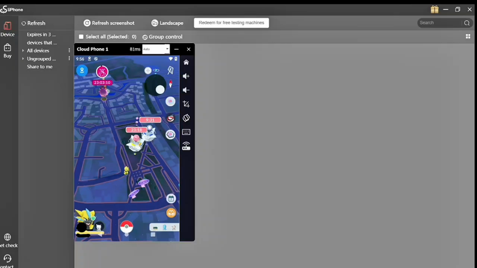
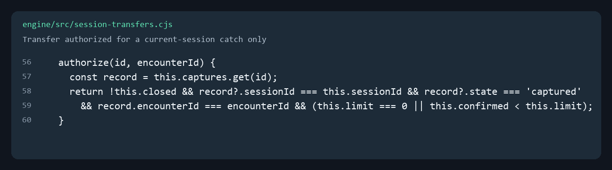
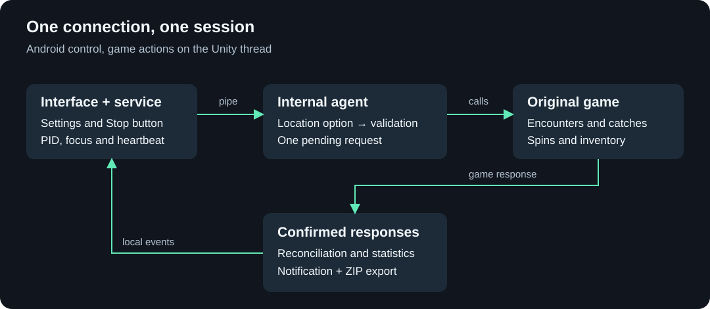

# SilphMod

[ENGLISH](README.md)

Automatización local para Pokémon GO original en una instancia **UGPhone con root Android 10**. Captura Pokémon cercanos, gira Poképaradas, transfiere nuevas capturas según tus filtros y mantiene la mochila dentro de los límites que elijas.

Configuras las funciones, pulsas **Start service** y sigues el progreso desde la notificación. **Stop** y **Export logs** permiten detener la sesión y revisar sus resultados. La interfaz, las notificaciones y los recursos visuales están en inglés.

**Edición:** `1.5.0-ugphone` · **Licencia del código propio:** [MIT](LICENSE) · **Entorno de referencia:** UGPhone Android 10, ARM64. **AÚN NO ESTÁ PROBADO EN OTRAS VERSIONES DE ADNROID O FUERA DE UGPHONE**. Próximamente se buscará ampliar la compatibilidad.

[Funciones](#funciones) · [Uso](#uso) · [Arquitectura](#arquitectura) · [Compilación](#compilación) · [Estado y próximas mejoras](#estado-y-próximas-mejoras)

## Cómo funciona

[](docs/assets/test%40KernelX-debug_01.mp4?raw=true)

## Compatibilidad

| Componente | Perfil de esta edición |
| --- | --- |
| Entorno observado | Instancia UGPhone con Android **10 / SDK 29** y permiso `su` |
| Arquitectura | **ARM64**, punteros de 64 bits |
| Juego | Pokémon GO original **0.431.0**, `versionCode 2026092402` |
| Motor del juego | Unity **6000.3.21f1**, IL2CPP |
| APK | `minSdk 29`, `targetSdk 36` |
| Tratamiento opcional de Error 12 | Limitado en esta edición a **SDK 29** |
| Identidad instalada | `dev.rootcatch.ugphonetest`, conservada para actualizar instalaciones anteriores |

La compatibilidad se describe por el **Android de la instancia**; los reportes no identifican la versión del cliente UGPhone. Android posteriores, otras ROM, teléfonos físicos y perfiles distintos del juego requieren validación independiente.

## Funciones

| Función | Comportamiento actual |
| --- | --- |
| Autocaptura | Selecciona el objetivo elegible más cercano a la posición actual y vuelve a comprobar su existencia y distancia antes de lanzar. |
| Poképaradas | Envía giros para objetivos dentro del alcance configurado en el motor y contabiliza respuestas exitosas. |
| Transferencias | Solo Pokémon capturados por **esta sesión de SilphMod**, con respuesta de captura acreditada e ID exacto. |
| Conservar shiny / 15/15/15 | Dos filtros independientes. Cumplir cualquiera de los filtros activos impide transferir ese Pokémon. |
| Limpiar mochila | Elimina excedentes de los tipos seleccionados **desde el inicio**, y mantiene esos límites durante la sesión. No necesita esperar a que la mochila se llene. |
| Solucionar error 12 | Tratamiento de ubicación dentro del proceso del juego, opcional y vinculado a la sesión. |
| Estadísticas | Capturas, huidas, giros, transferencias, objetos eliminados, XP, polvo estelar y tiempo. |
| Registros | Exportación manual de hasta tres sesiones recientes, con índice de tamaños y SHA-256. |

No hay ruta o joystick integrado: SilphMod trabaja con la posición que recibe el juego. Tampoco incorpora mapas mundiales, bases de apariciones ni un servicio de predicción shiny.

### Transferir sin tocar tu colección anterior

La cola de transferencias nace vacía. Un Pokémon entra únicamente cuando una petición de captura emitida por esta sesión obtiene una respuesta válida y exitosa con su ID de almacenamiento. Encontrar un ID en la colección **no basta** para autorizar su transferencia.

Además de los filtros elegidos, se conservan favoritos, compañeros, huevos, Pokémon desplegados, fusiones, clases especiales y registros cuya información de protección no puede validarse. Desmarcar **Keep shiny** o **Keep 15/15/15** permite transferir esas nuevas capturas si no existe otra protección.

Las transferencias están desactivadas inicialmente y **no tienen cuota total por sesión**. El motor recibe `maxTransfers = 0`; las preferencias antiguas no restauran un límite. No se heredan autorizaciones entre sesiones, cuentas ni reinicios.



*Este es un fragmento del archivo [session-transfers.cjs](engine/src/session-transfers.cjs), generado desde el código del repositorio.*

### Mochila: límites por tipo, no borrado indiscriminado

Una casilla habilitada permite eliminar el excedente de ese tipo; el número indica cuánto conservar. Un tipo desmarcado no se elimina. Por ejemplo:

```text
Potion=50,SuperPotion=50,Revive=30,NanabBerry=30
```

Con 83 pociones y un mínimo de 50, el plan permite eliminar 33. Cada petición elimina como máximo 50 unidades, **sin cuota total por sesión**. El motor comprueba la respuesta y la sincronización del inventario antes de continuar.

Hay **33 tipos seleccionables**, incluyendo tres Poké Balls comunes, cuatro pociones, dos revivires, cinco bayas y otros consumibles permitidos. El catálogo contiene otros **17 tipos protegidos**; Master Ball, Safari Ball, Premier Ball, pases, incubadoras y objetos desconocidos no se autorizan para descarte. Puedes revisar los IDs y restricciones en [ItemCatalog.java](app/src/main/java/dev/rootcatch/nativeengine/ItemCatalog.java) y [item-catalog.cjs](engine/src/item-catalog.cjs).

La limpieza está desactivada inicialmente. El motor recibe `maxDiscardedItems = 0`, independientemente de las preferencias anteriores. Puede borrar objetos que ya estaban en la mochila, conforme a los tipos y mínimos seleccionados. Una respuesta ambigua o un rechazo conocido pausa la limpieza sin repetir la petición; las demás funciones pueden continuar.

## Uso
Antes de todo, recuerda que debes de disponer de una aplicación GPS Joistick correctamente configurada.

1. Instala el APK desde la sección de lanzamientos, abrela y concede permiso root y notificaciones (En caso te lo pida). Mantén tu joystick configurado y funcionando. No ejecutes otros automatismos o inyectores simultáneamente.
2. Selecciona **Catches**, **Spin PokéStops**, filtros de transferencia y **Items to keep**. Las transferencias y los descartes no tienen un máximo total por sesión, es decir, eliminan una cantidad ilimitada de los objetos que hayas configurado para descartar.
3. Coloca una **ruta de recorrido** en tu aplicación GPS joistick o simplemente usa el Joistick de esta app para movilizarte por el mapa. Recuerda que la **ruta de recorrido** es recomendada para mayor efectividad del mod en mayor tiempo.
4. Si tu instancia necesita el tratamiento de ubicación (UGPHONE), marca **Fix error 12** y pulsa **Start service**. Permanece en SilphMod durante la preparación; puede demorar unos segundos en abrir el juego; la app puede cerrar únicamente el juego una vez y abrirlo para instalar el tratamiento temprano. No borra caché, almacenamiento ni ajustes del joystick.
Si das a **Start service** y no abre el proceso del juego, esto es algo normal, no debes alarmarte, lo que debes hacer es esperar a que guarde los logs del error y volver a pulsar **Start service**. Hacer esto las veces necesarias hasta que abra el juego y cargue el mapa.
5. Espera **Active**. Hay una comprobación automática de mapa, jugador y referencias antes de enviar acciones. Con la casilla de ubicación desmarcada, abre tú el juego y espera al mapa antes de iniciar el servicio.
6. Pulsa **Stop service** o **Stop** en la notificación. Y solo en caso de querer guardar el reporte de errores, espera a que termine **Saving logs…** y utiliza **Export logs**. El ZIP se guarda en `Descargas/SilphMod/`.

El servicio no tiene un temporizador de 30/60 segundos ni un límite fijo de horas. Para detenerlo, debes abrir la notificación de la app y darle en detener o en su defecto cerrar Pokémon Go y volver a la app del Mod.
Cambiar de app pausa las acciones; perder el proceso, cambiar de cuenta o perder prolongadamente el controlador termina la sesión. Abrir la barra de notificaciones puede pausar acciones si Android le asigna el foco: **esta edición todavía no diferencia ese panel de toda pérdida de foco**.

Si el almacenamiento Pokémon se llena, se pausan las capturas y se informa el estado; SilphMod no borra la colección anterior para hacer espacio. Con la mochila llena y sin excedentes autorizados, tampoco elimina otros objetos por su cuenta. Detener no puede revertir una operación que ya fue enviada.

## Arquitectura



SilphMod tiene dos partes que cooperan mediante una tubería local:

- **Android / Java:** interfaz, configuración, servicio en primer plano, permiso root, identidad del proceso, foco, control, notificación y exportación.
- **Agente / TypeScript y CommonJS:** resolución de servicios IL2CPP, selección de objetivos, solicitudes del juego, lectura de respuestas, filtros y ciclo de vida de referencias.

El agente utiliza objetos y métodos del proceso original; el cliente del juego sigue siendo quien serializa sus solicitudes y se comunica con su servidor. SilphMod no tiene permiso `INTERNET` ni una API propia de apariciones, pero **el juego necesita conexión**: esto no es un modo offline.

### Inicio y continuidad

Cuando la opción de ubicación está activa, el agente prepara primero el adaptador JNI y carga después los puentes Java/IL2CPP, tras un mínimo de ocho segundos y la presencia de las bibliotecas requeridas. Eso no acredita que el mapa esté listo: aún se validan escena, cuenta, firmas, referencias GC de 64 bits y muestras estables durante aproximadamente diez segundos.

La activación usa una autorización de un solo uso vinculada a proceso, sesión y jugador. No hay una desconexión/reinyección entre la validación y el farmer. Las acciones se ejecutan desde el hilo Unity; los objetos retenidos se liberan al terminar.

El controlador envía latidos cada **500 ms** en un hilo independiente de consultas de foco y escritura de registros. Solo una lectura positiva de foco de hasta **1.500 ms** puede autorizar acciones. El permiso para nuevas acciones caduca a los **2.200 ms**; una demora breve puede recuperarse en la misma conexión, mientras una pérdida continua de control superior a **10 segundos** termina la sesión. **No se reinicia automáticamente el juego después de un fallo.**

### Capturas y llamadas del juego

La ingeniería inversa se utilizó para identificar contratos, estructuras y firmas del perfil admitido. El motor resuelve clases y servicios en ejecución y valida lo que va a utilizar; no distribuye la biblioteca del juego ni su metadata decompilada.

| Operación | Entrada utilizada en el perfil 0.431.0 |
| --- | --- |
| Resolver servicios | `Zenject.Internal.ZenUtilInternal.GetAllSceneContexts` y `DiContainer.TryResolve(System.Type)` |
| Leer posición | `Niantic.Holoholo.Avatar.IMapAvatar.get_Location`, estructura `Niantic.LatLng` |
| Leer objetivos | `IMapPlaceDirectoryService.get_AllPokemon` / `get_ActivePokestops` |
| Abrir encuentro | `MapPokemon.SendEncounterRequest()` |
| Lanzar | `MapPokemon.TryCapture(PokeballThrow, ARPlusEncounterValuesProto)` |
| Girar | `IRpcHandler.SendRpc<FortSearchProto, FortSearchOutProto>`; ID de operación `101` |
| Reciclar objetos | `IRpcHandler.SendRpc<RecycleItemProto, RecycleItemOutProto>`; ID `137` |
| Transferir | `IPokemonBag.ReleasePokemon(pokemon)`, seguido de reconciliación por ID |

Las distancias del motor son **40 m para seleccionar capturas** y **80 m para giros**; son umbrales locales, no una promesa de que el servidor acepte una acción. El objetivo se vuelve a validar antes de cada lanzamiento, algo importante cuando el joystick está siguiendo una ruta.

El lanzamiento actual activa impacto y giro, con `ReticleSize = 0.5`. **No existe todavía un selector de excelente/gran lanzamiento** ni se garantiza una clasificación de recompensa específica. La elección de bola utiliza la primera disponible en el orden Poké Ball → Super Ball → Ultra Ball.
Próximamente se harán actualizaciones donde se incorporen funciones ampliadas y opción de tiro. Las capturas siempre van con lanzamiento curvo.

Solo hay una petición de acción pendiente. El intervalo de **250–3000 ms**, inicialmente **300 ms** en la interfaz, separa envíos; no significa una captura cada 300 ms. Respuestas, comprobaciones, disponibilidad de objetivos y reconciliación también consumen tiempo.

```ts
// Fragmento del motor: abrir el encuentro y retener su promesa.
reserve(
  'encounter',
  object(pokemon.method<Obj>('SendEncounterRequest', 0).invoke()),
  nearestId,
  [pokemon]
);
```

*Fragmento simplificado de [agent.ts](engine/src/agent.ts): el archivo completo incluye comprobaciones, trazas y gestión de errores alrededor de la llamada.*

### Transferencias y borrado: confirmar antes de contabilizar

Los identificadores de 64 bits permanecen como cadenas exactas o valores `UInt64`, nunca como números JavaScript susceptibles de perder precisión. La autorización combina petición emitida, respuesta reciente y exitosa, clase correcta, ID capturado y sesión actual.

La política de mochila es independiente de la animación o de que visualmente parezca llena:

```js
// Fragmento real de engine/src/policy.cjs
const count = counts[name];
if (!Number.isInteger(count) || count <= keep) continue;
return {
  name, item: ITEMS[name], count: Math.min(count - keep, maxBatch),
  before: count, keep
};
```

Una transferencia no incrementa el contador únicamente por haber sido solicitada: también debe desaparecer del inventario tras la respuesta aceptada. Los resultados desconocidos no autorizan reintentos irreversibles.

### Ubicación y Error 12: alcance real de la casilla

El adaptador usa la ABI JNI para identificar `android.location.Location.isFromMockProvider()` y, si existe, `isMock()`. Trata únicamente las respuestas booleanas correspondientes a esos métodos dentro del **proceso al que se conectó**. No modifica coordenadas, objetos `Location`, AppOps, servicios de Google, SELinux ni módulos del sistema.

Es un tratamiento temporal ligado a la sesión, no una reparación permanente del dispositivo ni una solución universal para todas las causas de Error 12. Al detener y retirar los hooks, el error puede regresar. La implementación de esta función está en [engine/location](engine/location).

### XP y polvo estelar

Se contabilizan las recompensas de respuestas exitosas de **capturas y giros de esta sesión**: `CaptureScoreProto.Exp`, `Stardust`, recompensas de evolución temporal/mega y `FortSearchOutProto.XpAwarded`, `Loot` y `BonusLoot` según el contrato validado.

No se resta el saldo de la cuenta ni se estiman premios multiplicando capturas por una constante. No se vuelven a multiplicar los importes por bonos que ya pudiera haber aplicado el juego. Una secuencia creciente evita duplicados; los totales Android usan `long`. `—` indica lectura no disponible y `+` un total parcial con recompensas faltantes.

## Evidencia de funcionamiento actual

El reporte revisado el **7 de octubre de 2026** permite documentar una sesión de **1.3.1-ugphone** con aproximadamente **2 h 6 min 31 s de actividad**, calculados con el reloj monotónico del controlador hasta su solicitud de parada.

| Resultado confirmado | Total |
| --- | ---: |
| Capturas | 1.365 |
| Huidas | 34 |
| Giros | 532 |
| Transferencias | 1.362 |
| Unidades de objetos eliminadas | 634 |
| XP | 416.800 |
| Polvo estelar | 360.650 |
| Recibos de recompensa ilegibles registrados | 0 |

Se verificaron tamaños y SHA-256 de **60 archivos indexados**, sin discrepancias. La sesión terminó por **cambio de identidad del proceso del juego**. Los registros están rotados y no conservan cada evento histórico.

## Compilación

Requisitos: JDK **17 o superior**, Android SDK **36**, Node.js **22 o superior** y Python **3.11 o superior**. Android Studio puede abrir la raíz del repositorio. Configura `JAVA_HOME` y `ANDROID_HOME`, o crea tu propio `local.properties` con `sdk.dir`; ese archivo no se publica.

```powershell
cd engine
npm.cmd ci
npm.cmd run typecheck
npm.cmd test
cd ..
python tools/prepare_native.py
.\gradlew.bat :app:testDebugUnitTest :app:lintRelease :app:assembleRelease
```

En Linux/macOS utiliza `npm` y `bash ./gradlew` en lugar de `npm.cmd` y `gradlew.bat`. La preparación nativa descarga el ejecutable oficial ARM64 de **Frida 17.22.1**, verifica archivo comprimido, binario, tamaño y formato ELF, y no lo ejecuta en el ordenador. También acepta `--archive /ruta/al/archivo-oficial.xz` para una preparación offline.

Gradle reconstruye el agente desde el código fuente y genera su SHA-256 esperado durante la compilación. No necesitas editar una constante a mano ni copiar archivos desde otro proyecto. El binario nativo se verifica de nuevo antes de compilar.

Sin configuración de firma, la salida release es **unsigned**. Para firmarla, proporciona por entorno `SILPH_KEYSTORE`, `SILPH_STORE_PASSWORD`, `SILPH_KEY_ALIAS` y `SILPH_KEY_PASSWORD`. Las claves quedan fuera del repositorio; actualizar una instalación existente requiere el mismo certificado.

Salida Android: `app/build/outputs/apk/release/`. El APK, `node_modules`, caches, logs, claves y runtime descargado están excluidos de Git.

### Comprobaciones

Las pruebas Node ejercitan políticas y contratos con objetos sintéticos, además del agente real empaquetado con puentes simulados. Las pruebas JVM cubren configuración, control, foco, exportación y arranque. **No sustituyen ejecución nativa en Android.** Las pruebas de sintaxis Bash se omiten de manera explícita si Bash no está disponible.

La auditoría de esta versión está en [build-1.5.0.json](docs/validation/build-1.5.0.json). Los cambios se concentran en traducción  y presentación; se conservan llamadas de captura, filtros, reconciliación y plazos de control.

Validación local: **252 pruebas Node superadas**, **123 pruebas JVM superadas y 2 omitidas** por restricciones de enlaces simbólicos de Windows, TypeScript correcto y **0 incidencias de lint**. También se verifican integridad del agente y firma del APK. La prueba de esta versión en UGPhone queda pendiente.

Para auditar un APK firmado contra sus assets, permisos, firma, pruebas JVM y lint:

```powershell
python tools/verify_apk.py app/build/outputs/apk/release/app-release.apk
```

Para preparar una carpeta y ZIP de fuentes sin archivos de compilación, usa `tools/package_source.py --directory ../SilphMod-public --zip ../SilphMod-source.zip`. Se niega a sobrescribir distribuciones existentes y excluye binarios nativos, claves, dependencias instaladas y registros. Los recursos visuales están incluidos; la imagen de código puede regenerarse con `tools/render_code.py --font /ruta/a/una/fuente-mono.ttf` y Pillow.

## Registros y privacidad

La exportación es local y manual. Incluye estado final, configuración, eventos del motor, salud, arranque, fuentes Android accesibles, logcat y reportes de cierre, con límites de tiempo/tamaño y rotación. No equivale a recoger toda la memoria ni a conservar cada línea de una sesión indefinidamente. Las sesiones antiguas no se eliminan automáticamente: revisa el espacio disponible.

Los ZIP **no añaden censura** y pueden incluir coordenadas, identificadores y mensajes de otros procesos. Que una coordenada provenga de un joystick no hace públicos los demás datos. Revisa los informes antes de compartirlos. Este repositorio solo incorpora estadísticas agregadas seleccionadas para documentación.

## Estructura

```text
SilphMod/
├── app/                  # Una sola aplicación Android
├── engine/
│   ├── src/              # Motor, políticas y control de sesión
│   ├── location/         # Adaptador JNI
│   ├── test/             # Pruebas del motor
│   └── location-test/    # Pruebas del adaptador
├── docs/
│   ├── assets/           # Identidad, arquitectura y fragmento de código
│   └── validation/       # Evidencia agregada y auditoría de compilación
├── tools/                # Preparación nativa y distribución de fuentes
├── gradle/               # Wrapper de compilación
├── LICENSE
├── NOTICE
└── README.md
```

## Estado y próximas mejoras

**1.5.0 incorpora la interfaz y los recursos visuales**, y elimina las cuotas totales de transferencia y descarte. Mantiene el motor de la distribución independiente anterior.

Algo a recalcar es que el **motor**, no SilphMod, fue probado en múltiples versiones de android, dando resultados positivos; esto no significa que funcione con todos los dispositivos de forma correcta, aún existen errores de incompatibilidad y errores nativos `SIGSEGV / SEGV_ACCERR` con llamadas en `libNianticLabsPlugin.so` (Se seguirán investigando estos errores).

La siguiente fase es medir tiempos de respuesta y reconciliación, latencia de foco/control y coste del registro. También quedan pendientes distinguir el panel de notificaciones de otras apps y ampliar la matriz de dispositivos.

Se buscará agregar una mejor interfaz para seleccionar objetos a eliminar en el juego, además de agregar opción a elegir la calidad de lanzamiento, además del orden jerárquico del uso de pokebolas.

Algo pendiente también es ampliar el catálogo de pokemones configurados para no transferir, identificándolos por fondo, dynamax, nundos(0/0/0), etc.

SilphMod no elimina restricciones del servidor, cooldowns ni riesgos para la cuenta. Transferencias y descartes son irreversibles. La automatización puede infringir las condiciones del juego; utiliza el proyecto con conocimiento de esos límites. No es recomendable su uso en cuentas que consideres valiosas.

Licencia [MIT](LICENSE). Las dependencias conservan sus avisos en [NOTICE](NOTICE) y sus licencias dentro de los assets. Proyecto independiente, sin afiliación con los titulares del juego.
