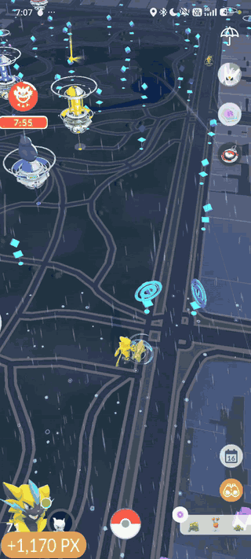

# SilphMod

**[English](README.md) · Español**

Automatización local para Pokémon GO original en **Android con root**, tanto en UGPhone como en teléfonos físicos ARM64. Captura de Pokémon cercanos, gira Poképaradas, recoge investigaciones de campo, semanales, especiales y de eventos, reclama recompensas del GO Pass, transfiere nuevas capturas según tus filtros y mantiene la mochila dentro de los límites que elijas.
Los modos **Kecleon (BETA)**, **AutoRocket (BETA)** y **Event tricks** tienen su propia configuración, notificación y estadísticas.

Configuras las funciones, pulsas **Start service** y sigues el progreso desde la notificación. **Stop** y **Export logs** permiten detener la sesión y revisar sus resultados. La interfaz, las notificaciones y los recursos visuales están en inglés.

**Edición:** `2.3.15` · [MIT](LICENSE)

**Plataforma:** Android 10 o posterior, ARM64 y root. Una misma APK para UGPhone y teléfonos físicos.

<details>
<summary>Contenido</summary>

- [Cómo funciona](#cómo-funciona)
- [Compatibilidad](#compatibilidad)
- [Funciones](#funciones)
  - [Kecleon (BETA)](#kecleon-beta)
  - [AutoRocket (BETA)](#autorocket-beta)
  - [Event tricks](#event-tricks)
  - [Only catch: escoger qué Pokémon capturar](#only-catch-escoger-qué-pokémon-capturar)
  - [Select Pokémon to keep](#select-pokémon-to-keep)
  - [Compañero](#compañero)
  - [Transferir sin tocar la colección anterior](#transferir-sin-tocar-la-colección-anterior)
  - [Mochila: límites por tipo, no borrado indiscriminado](#mochila-límites-por-tipo-no-borrado-indiscriminado)
  - [Límites de captura y giros](#límites-de-captura-y-giros)
- [Uso](#uso)
- [Arquitectura](#arquitectura)
  - [Inicio y continuidad](#inicio-y-continuidad)
  - [Integridad y canal de control](#integridad-y-canal-de-control)
  - [Recuperación automática del mapa](#recuperación-automática-del-mapa)
  - [Capturas y llamadas del juego](#capturas-y-llamadas-del-juego)
  - [Alcance y prioridad de captura](#alcance-y-prioridad-de-captura)
  - [Inciensos y acciones de evento](#inciensos-y-acciones-de-evento)
  - [Throw quality](#throw-quality)
  - [Bayas](#bayas-confirmar-el-efecto-antes-de-lanzar)
  - [Interrupciones y continuidad del mapa](#interrupciones-y-continuidad-del-mapa)
  - [Investigaciones de campo y logro semanal](#investigaciones-de-campo-y-logro-semanal)
  - [Investigaciones especiales y de eventos](#investigaciones-especiales-y-de-eventos)
  - [GO Pass](#go-pass)
  - [Remove buddy](#remove-buddy)
  - [Inventory tools](#inventory-tools)
  - [Game tools: regalos y nombre temporal](#game-tools-regalos-y-nombre-temporal)
  - [Transferencias y borrado](#transferencias-y-borrado)
  - [Ubicación y Error 12](#ubicación-y-error-12)
  - [Contador XP y polvo estelar](#contador-xp-y-polvo-estelar)
- [Compilación](#compilación)
- [Registros y privacidad](#registros-y-privacidad)
- [Estructura](#estructura)
- [Estado y próximas mejoras](#estado-y-próximas-mejoras)

</details>

## Cómo funciona



## Compatibilidad

| Componente | Perfil de esta edición |
| --- | --- |
| Sistema | Android **10 o posterior** y permiso `su` |
| Entornos | UGPhone y teléfonos físicos ARM64 con root |
| Arquitectura | **ARM64**, punteros de 64 bits |
| Juego | Pokémon GO original **0.435.1**, `versionCode 2026102802` |
| Motor del juego | Unity **6000.3.22f1**, IL2CPP |
| APK | `minSdk 29`, `targetSdk 36` |
| Tratamiento opcional de Error 12 | Contratos JNI de `Location` resueltos según la versión del sistema |
| Conexión | Selección adaptativa entre cuatro rutas de arranque y reutilización de la que funcionó para el entorno |
| Identidad instalada | `dev.rootcatch.ugphonetest`, conservada para actualizar instalaciones anteriores |

La aplicación reúne **Farmer**, **Kecleon (BETA)**, **AutoRocket (BETA)** y **Event tricks**, con ejecución independiente y estadísticas separadas. El arranque se adapta al **Android del dispositivo o de la instancia**.

## Funciones

| Función | Comportamiento actual |
| --- | --- |
| Autocaptura | Selecciona el objetivo elegible más cercano hasta **50 m**, y vuelve a comprobar su existencia y distancia antes de lanzar. Reintenta mientras el encuentro siga siendo válido; si desaparece o sale del alcance, pasa al siguiente objetivo. |
| Inciensos | Captura las apariciones del incienso normal y del incienso diario, también cuando sus duraciones se acumulan. Mantiene los filtros de especie, bayas y protecciones de transferencia del Farmer. |
| Automatic event actions | Interactúa con las cajas de Halloween dentro de **50 m**, recoge sus recompensas y captura los Pokémon que entregan. Activada inicialmente en Farmer. |
| Only catch | Selección de una o varias especies con miniaturas, búsqueda y orden de Pokédex. Sin selección, captura todas las especies elegibles. Los encuentros de investigación de campo, logro semanal, especiales, de eventos y GO Pass se capturan independientemente de este filtro. |
| Select Pokémon to keep | Conserva las especies y formas seleccionadas cuando el Farmer las capture, aunque no cumplan otros filtros de conservación. No cambia la selección de Only catch. |
| Compañero | **Feed buddy** lo alimenta según la prioridad de bayas y **Mega Evolve buddy** utiliza la megaevolución disponible de menor coste. Detecta cambios de compañero durante la sesión. |
| Throw quality | Selecciona **Normal**, **Nice**, **Great** o **Excellent**. Los lanzamientos mantienen el giro de bola curva. |
| Bayas | Usa la primera baya disponible según la selección y prioridad configuradas, confirma su aplicación y continúa con el lanzamiento. Mantiene los límites de Item limits. |
| Poképaradas | Envía giros para objetivos dentro del alcance configurado en el motor y contabiliza respuestas exitosas. |
| Límites de sesión | Máximos configurables de capturas y giros, inicialmente **4.800** y **2.400**, aplicados a las estadísticas acumuladas. Alcanzar cualquiera detiene el farmeo, cierra Pokémon GO y guarda los registros. |
| Interrupciones | Cierre automático de medallas, subida de nivel, recompensas de XP, resumen del incienso diario, eclosiones, aviso de velocidad, aviso de Stamp Rally, subida de nivel de amistad y diálogos de investigación de Willow. Se prepara desde el inicio del motor. |
| Investigaciones de campo y semanales | Reclama recompensas disponibles, captura sus encuentros y recoge el logro semanal pendiente antes de continuar con las tareas de campo. Descarta tareas incompatibles, incluidas caminar kilómetros y conseguir caramelos con el compañero. Conserva el espacio de escaneo AR; el descarte se limita a tareas de campo. |
| Investigaciones especiales y de eventos | Reclama las recompensas disponibles de tareas y etapas, y captura sus encuentros. Mantiene las tareas incompletas y deja las elecciones de rama al usuario. |
| GO Pass | Reclama las recompensas desbloqueadas del pase actual y captura sus encuentros. Los objetos, XP y polvo estelar se contabilizan según las respuestas del juego. |
| Remove buddy | Retira el compañero al iniciar, sin transferirlo ni volver a asignarlo al terminar. Desactivado inicialmente. |
| Transferencias | Solo Pokémon capturados por **esta sesión de SilphMod**, con respuesta de captura acreditada e ID exacto. |
| Conservar shiny / 15/15/15 | Dos filtros independientes. Cumplir cualquiera de los filtros activos impide transferir ese Pokémon. |
| Conservar Dynamax / eclosionados / fondo | Nuevos filtros de protección para las capturas autorizadas por el servicio. No recorren ni modifican la colección anterior. |
| Conservar shiny + fondo | Protege los Pokémon que cumplen ambas condiciones. Se combina con los demás filtros de conservación. |
| Conservar encuentros de investigación | **Keep field research encounters** protege las capturas de campo, del logro semanal, de investigaciones especiales y de eventos. Si se desactiva, siguen aplicándose los filtros shiny, IV y demás protecciones globales. |
| Conservar encuentros del GO Pass | **Keep GO Pass encounters**, activado inicialmente, protege las capturas del pase por su origen. Los legendarios permanecen protegidos incluso con esta casilla desactivada. |
| Show IV names | Muestra temporalmente el porcentaje entero y los IV en el inventario. Los **15/15/15** aparecen en rojo en la lista y en su ficha, sin renombrar los Pokémon de la cuenta. |
| Extended manual transfer | Amplía la selección manual múltiple de Pokémon especiales desde el inventario del juego. Es independiente de las transferencias automáticas. |
| Fast gift opening | Acelera la apertura manual de regalos, la presentación de sus objetos y las esperas locales de esa secuencia. Activado inicialmente en **Game tools**. |
| Auto-open gifts / Auto-send gifts | Abre y envía regalos a los amigos disponibles durante la sesión, sin detener el Farmer. Con la mochila llena, la apertura solicita la conversión a polvo estelar. Ambas opciones vienen desactivadas inicialmente. |
| Hide trainer name | Muestra temporalmente **SilphMod** en el HUD, el perfil propio y la cabecera de amigos desde que se conectan sus componentes al iniciar el motor. El nombre de la cuenta no cambia. Activado inicialmente en **Game tools**. |
| Limpiar mochila | Elimina excedentes de los tipos seleccionados **desde el inicio**, y mantiene esos límites durante la sesión. No necesita esperar a que la mochila se llene. |
| Kecleon (BETA) | Búsqueda y captura automática de candidatos, con filtros e historial por cuenta. Esto aún está en desarrollo. |
| AutoRocket (BETA) | Recorre solo candidatos de reclutas normales (por ahora), valida la incidencia, combate, captura según los filtros y cura al equipo entre combates. Incluye equipo recomendado, dos escudos y ubicación de retorno para las capturas (Método Alan). |
| Solucionar error 12 | Tratamiento de ubicación dentro del proceso del juego, opcional y vinculado a la sesión. |
| Estadísticas | Capturas, huidas, giros, transferencias, objetos eliminados, XP, polvo estelar y tiempo activo acumulados. Se conservan al detener, volver a iniciar y recuperar el mapa. |
| Clear statistics | Restablece únicamente los contadores del modo abierto, con el servicio detenido. En Kecleon también limpia su historial de candidatos; en AutoRocket elimina el historial y la ubicación de retorno. Se encuentra debajo de las estadísticas. |
| Recuperación del mapa | Tras cinco minutos de lecturas válidas sin apariciones en el directorio del mapa, reinicia el juego y vuelve a conectar el motor. Hasta **10 intentos de arranque por recuperación**, cancelables con Stop. Se desactiva al seleccionar especies en **Only catch**. |
| Barra de notificaciones | Las capturas y los giros continúan al desplegarla si Pokémon GO sigue siendo la app subyacente y la pantalla está desbloqueada. También continúa en la mochila, el inventario Pokémon, la ficha individual de un Pokémon, el perfil propio, la tienda y la Pokédex. Los avisos informativos de progreso de misiones y recompensas permiten continuar mientras el mapa permanezca visible. |
| Integridad y control | Verificación de componentes antes del arranque y canal local vinculado al proceso y a la sesión, con credenciales fuera de los argumentos y de los nuevos registros. |
| Recuperación de conexión | Reintenta desconexiones recuperables del canal nativo, conserva estadísticas y valida de nuevo el proceso y la cuenta. Los reintentos respetan Stop y los límites de sesión. |
| Registros | Exportación manual de hasta tres sesiones recientes en un ZIP local. |

Farmer utiliza la ruta que configures en tu joystick. Kecleon y AutoRocket necesitan la integración pública de **GPS JoyStick de The App Ninjas** para hacer sus saltos automáticos.

### Kecleon (BETA)

Este modo recorre candidatos de **Moonani**, se desplaza con GPS JoyStick, busca la Poképarada correspondiente y comprueba su incidencia activa. Resuelve `fort_id`, incidencia y `encounter_id` desde el juego antes de abrir el encuentro.

El HTML se procesa fila por fila y los candidatos se guardan en una cola temporal dentro del almacenamiento privado de la app, sin cargar la página completa en memoria. La lista puede crecer sin los anteriores topes de tamaño, filas o candidatos. Las entradas se ofrecen una a una al motor, con el mismo historial por cuenta para evitar repeticiones. Al detener la sesión se elimina la cola temporal.

La carga del mapa se acompaña de movimientos acotados de **ocho metros** y lecturas espaciadas. Un tiempo agotado se guarda como **no verificado**, no como prueba de que allí no había Kecleon. El historial separa las cuentas y evita volver a procesar candidatos ya resueltos.

Los filtros **Only catch 15/15/15**, **Only catch 0/0/0**, **Only catch shiny** y **Only catch shiny + 15/15/15** se combinan con «O». La última opción exige simultáneamente shiny e IV perfectos. Sin filtros se capturan todos los Kecleon válidos encontrados.

**Maximum encounters** limita sus encuentros acumulados. Al llegar al máximo o agotar los candidatos pendientes, se cierra el juego y se muestra el motivo. **Clear statistics** borra sus contadores y el historial de candidatos. Farmer conserva sus propios resultados.

Kecleon comparte calidad de tiro, bayas, límites de mochila y herramientas de inventario y presentación. Sus estadísticas muestran **Encounters**, **Catches**, **Shinies**, **Items deleted**, **XP** y **Stardust**. No gira Poképaradas ni transfiere su colección.

### AutoRocket (BETA)

Este modo recorre candidatos de reclutas normales de **NYCPokeMap**, comprueba su hora de aparición y desaparición y valida en el juego la Poképarada y su incidencia activa. El feed se actualiza cada **30 segundos**. Si encuentra una Poképarada sin el recluta esperado o con Kecleon, continúa con el siguiente candidato. Esta edición trabaja con reclutas normales por ahora.

Puedes donar, en agradecimiento por el gran trabajo del creador de dicho mapa gratuito: https://www.paypal.com/paypalme/SGPokeMap/10USD

La carga del mapa utiliza movimientos acotados de **ocho metros** y lecturas espaciadas. La entrada al combate, los ataques, los escudos y la captura se realizan mediante los servicios del juego. Se omiten los diálogos de entrada y resultado, la presentación del enfrentamiento y la obtención de gemas purificadoras.

**Use recommended team**, activada inicialmente, prepara el equipo recomendado en cada combate. Al desactivarla, utiliza la selección del usuario. Comprueba la salud del equipo antes de empezar, usa los dos escudos en las primeras oportunidades y lanza los ataques cargados disponibles, incluido el segundo cargado. Si pierde, cierra las pantallas de derrota y continúa con la recuperación del equipo.

Entre combates cura y revive únicamente a los tres Pokémon utilizados. **Potion priority** y **Revive priority** permiten escoger el orden de uso de los objetos. Usa las aplicaciones necesarias hasta completar la recuperación del equipo. Si faltan objetos, comprueba si puede preparar un equipo apto antes de iniciar otro combate.

**Catch all**, activada inicialmente, captura todos los encuentros oscuros válidos. Al desactivarla, permite combinar **Only catch 15/15/15**, **Only catch 0/0/0**, **Only catch shiny**, **Only catch shiny + 15/15/15** y **Only catch 13/13/13 or above**. Los filtros se combinan con «O»; shiny + 15/15/15 exige ambas condiciones, y 13/13/13 or above exige que cada IV sea al menos 13.

En **Engine settings**, **Last cooldown location** permite indicar unas coordenadas de retorno para capturar desde el primer encuentro aceptado. Si el campo está vacío, utiliza la ubicación de la primera captura Rocket confirmada de esa sesión. Después de cada combate, vuelve a ese punto antes de capturar los encuentros que cumplan los filtros. Un encuentro descartado por los filtros no fija esa ubicación.

**Maximum Rockets** limita los combates completados acumulados y viene en **700**. Las estadísticas muestran **Rockets**, **Catches**, **Shinies**, **Items deleted**, **XP** y **Stardust**. **Clear statistics** restablece esos contadores, el historial de candidatos y la ubicación de retorno. La calidad de tiro, las bayas y los límites de mochila se mantienen en la configuración compartida.

Los encuentros se capturan sin abrir la cámara. Si el juego presenta la ficha del Pokémon recién capturado o un récord de tamaño, se cierra únicamente la pantalla asociada a esa captura. **Stop** cancela las acciones pendientes y salir a otra app pausa el modo; scrcpy, capturas de pantalla y grabación conservan el mismo tratamiento de foco del Farmer. AutoRocket mantiene sus capturas y no transfiere la colección.

### Only catch: escoger qué Pokémon capturar

**Only catch** permite escoger una o varias especies para las siguientes sesiones. El selector utiliza un catálogo local con miniaturas, orden de Pokédex y búsqueda por nombre o número. La selección queda guardada; si la dejas vacía, el farmer vuelve a capturar todas las especies elegibles.

El catálogo incluye formas regionales de Alola y Galar, además de las especies normales. Incorpora Minior, Mimikyu y Bramblin. La opción general de Minior permite capturar sus apariciones independientemente del color que se revele después de capturarlo.

El filtro se aplica antes de abrir un encuentro salvaje y se vuelve a comprobar antes de usar una baya o lanzar. Seleccionar una especie no modifica sus IV ni condiciona los filtros de conservación: estos se aplican después de capturar.

El selector prepara una máscara de especies que el motor consulta antes de abrir el encuentro. Las capturas de investigación de campo, logro semanal, especiales, de eventos y GO Pass usan orígenes de recompensa separados y no quedan bloqueadas por **Only catch**.

Cuando hay especies seleccionadas, no se activa la recuperación por cinco minutos sin Pokémon: el farmer puede esperar a que aparezcan esas especies sin reiniciar el juego. **Stop**, los límites acumulados y el control de conexión siguen funcionando de la misma forma.

### Select Pokémon to keep

Esta selección aparece debajo de **Keep GO Pass encounters**, dentro de las opciones de transferencia del Farmer. Utiliza el mismo catálogo, miniaturas, búsqueda y orden de Pokédex que **Only catch**, incluidas las formas regionales.

Los Pokémon seleccionados se conservan cuando el Farmer los capture, independientemente de que cumplan los demás filtros de conservación. **Only catch** sigue decidiendo qué apariciones salvajes se capturan; esta selección no fuerza capturas de especies excluidas.

Inicialmente conserva **Articuno de Galar**, **Zapdos de Galar**, **Moltres de Galar**, **Gimmighoul** y **Meltan**. Se aplica también a las capturas de incienso y a los encuentros de sus cajas cuando los entregue el juego. Las demás protecciones globales de transferencia siguen activas.

### Compañero

La sección **Buddy** del Farmer incluye **Feed buddy**, su propia **Berry priority** y **Mega Evolve buddy**. Ambas casillas vienen desactivadas inicialmente.

La alimentación comienza al iniciar el servicio cuando el compañero lo necesita y vuelve a revisarse durante la sesión. Usa las bayas disponibles en el orden elegido, detecta si cambias de compañero y respeta los límites de mochila. Si no hay bayas, espera a que vuelvan a estar disponibles mientras el Farmer continúa.

La megaevolución comprueba las opciones del compañero actual y elige la disponible de menor coste. Puede utilizar megaenergía si hace falta; si no alcanza la energía o el compañero no tiene una opción válida, continúa el farmeo.

Si no hay compañero o está marcada **Remove buddy**, no se ejecutan estas acciones.

### Transferir sin tocar la colección anterior

La cola de transferencias nace vacía. Un Pokémon entra únicamente cuando una petición de captura emitida por esta sesión obtiene una respuesta válida y exitosa con su ID de almacenamiento. Encontrar un ID en la colección **no basta** para autorizar su transferencia.

Además de los filtros elegidos, se conservan favoritos, compañeros, huevos, Pokémon desplegados, fusiones, legendarios, míticos o singulares, Ultraentes y registros cuya información de protección no puede validarse. Desmarcar **Keep shiny** o **Keep 15/15/15** permite transferir esas nuevas capturas si no existe otra protección.

Se incluyen **Keep Dynamax**, **Keep hatched**, **Keep background** y **Keep shiny + background**. Las tres primeras vienen activadas inicialmente; la combinación shiny + fondo viene desactivada. Cumplir cualquiera de los filtros marcados conserva el Pokémon. Dentro de **Keep shiny + background**, en cambio, deben cumplirse las dos condiciones a la vez.

Si marcas **Keep shiny** junto con **Keep shiny + background**, se conservan todos los shiny, tengan fondo o no. Si marcas **Keep background** junto con la combinación, se conservan todos los que tengan fondo. Para conservar únicamente shiny con fondo mediante estos filtros, deja marcada solo la combinación y desmarca los demás filtros opcionales. El motor sigue capturando los otros Pokémon y los transfiere si no existe otra protección.

La protección de eclosionados se consulta en el registro autorizado para transferencia; no convierte las eclosiones en nuevas autorizaciones ni añade Pokémon de la colección anterior a la cola.

**Keep field research encounters**, activado inicialmente, conserva por origen las capturas de investigación de campo, del logro semanal, especiales y de eventos. **Keep GO Pass encounters**, también activado inicialmente, hace lo mismo con las capturas del pase. Desactivar una de estas opciones permite transferir las capturas de ese origen cuando no cumplen ninguna otra protección.

**Keep shiny**, **Keep 15/15/15**, **Keep shiny + background** y los demás filtros globales se aplican a todos los orígenes: salvaje, campo, semanal, especial, de evento y GO Pass. Los filtros se combinan con «O»: basta cumplir uno para conservar el Pokémon. Los legendarios, míticos o singulares y Ultraentes permanecen protegidos en todos los orígenes, aunque sus casillas de conservación estén desactivadas. Los encuentros comunes pueden transferirse según los filtros restantes.

Las transferencias están desactivadas inicialmente y **no tienen cuota total por sesión**. No se recuperan cuotas antiguas de transferencia. No se heredan autorizaciones entre sesiones, cuentas ni reinicios.

La autorización se implementa en [core.c](native/core.c), [farmer-actions.c](native/farmer-actions.c) y [transfer-policy.c](native/transfer-policy.c).

### Mochila: límites por tipo, no borrado indiscriminado

Una casilla habilitada permite eliminar el excedente de ese tipo; el número indica cuánto conservar. Un tipo desmarcado no se elimina. Por ejemplo:

```text
Potion=50,SuperPotion=50,Revive=30,NanabBerry=30
```

Con 83 pociones y un mínimo de 50, el plan permite eliminar 33. Cada petición elimina como máximo 50 unidades, **sin cuota total por sesión**. El motor comprueba la respuesta y la sincronización del inventario antes de continuar.

Hay **33 tipos seleccionables**, incluyendo tres Poké Balls comunes, cuatro pociones, dos revivires, cinco bayas y otros consumibles permitidos. El catálogo contiene otros **17 tipos protegidos**; Master Ball, Safari Ball, Premier Ball, pases, incubadoras y objetos desconocidos no se autorizan para descarte. Puedes revisar los IDs y restricciones en [ItemCatalog.java](app/src/main/java/dev/rootcatch/nativeengine/ItemCatalog.java).

La limpieza está desactivada inicialmente. No se aplica una cuota total de objetos descartados. Puede borrar objetos que ya estaban en la mochila, conforme a los tipos y mínimos seleccionados. Una respuesta ambigua o un rechazo conocido pausa la limpieza sin repetir la petición; las demás funciones pueden continuar.

### Límites de captura y giros

En **Engine settings → Session limits**, **Maximum catches** comienza en **4800** y **Maximum PokéStop spins** en **2400**. Ambos aceptan un máximo positivo y conservan el valor elegido para las siguientes sesiones.

Los contadores se conservan entre inicios del servicio y recuperaciones automáticas. Solo consumen el límite las respuestas exitosas de las acciones emitidas por SilphMod: no los intentos fallidos, las huidas ni las capturas manuales. Son máximos sobre las estadísticas locales acumuladas.

Si las capturas o los giros acumulados ya alcanzan su máximo, **Start service** queda bloqueado y muestra **Capture limit reached** o **Spin limit reached**. Para continuar, aumenta los límites por encima de ambos totales o utiliza **Clear statistics** con el servicio detenido. Detener el farmer no borra los resultados; limpiar estadísticas tampoco borra los logs.

Al alcanzar cualquiera de los dos máximos, no se envían más acciones. El agente retira sus hooks, libera sus referencias y confirma la parada; después Android verifica la identidad del proceso, cierra Pokémon GO y guarda los registros con el motivo y los resultados finales. **Export logs** permite recuperar el ZIP. El cierre no borra caché, almacenamiento ni configuración del juego.

## Uso

Antes de todo, recuerda que debes de disponer de una aplicación GPS Joistick correctamente configurada.

1. Instala el APK desde la sección de lanzamientos, abrela y concede permiso root y notificaciones (En caso te lo pida). Mantén tu joystick configurado y funcionando. No ejecutes otros automatismos o inyectores simultáneamente. Pon a SilphMod en modo sin restricciones en batería.

2. Selecciona **Catches**, **Only catch**, **Throw quality**, **Use berries**, **Berry priority**, **Remove buddy**, **Spin PokéStops**, filtros de transferencia e **Items to keep**, según lo que quieras utilizar. En Farmer, **Automatic event actions** controla las interacciones con las cajas del evento. En AutoRocket, elige **Catch all** o sus filtros, **Use recommended team**, **Maximum Rockets** y, si quieres, **Last cooldown location**. En **Inventory tools** puedes activar los nombres por IV y la transferencia manual ampliada. En **Game tools** puedes elegir **Fast gift opening**, **Auto-open gifts**, **Auto-send gifts** y **Hide trainer name**. Los filtros **Keep field research encounters** y **Keep GO Pass encounters** permiten conservar las capturas de esas recompensas. Ajusta los máximos de capturas y giros en **Engine settings**. Las transferencias y los descartes no tienen un máximo total propio por sesión, es decir, eliminan una cantidad ilimitada de los objetos que hayas configurado para descartar mientras la sesión permanezca activa.

3. Coloca una **ruta de recorrido** en tu aplicación GPS joistick o simplemente usa el Joistick de esta app para movilizarte por el mapa. Recuerda que la **ruta de recorrido** es recomendada para mayor efectividad del mod en mayor tiempo.

4. Si tu dispositivo o instancia necesita el tratamiento de ubicación, marca **Fix error 12** y pulsa **Start service**. SilphMod abre Pokémon GO y prepara la conexión correspondiente al sistema. El arranque puede cerrar únicamente el juego y volver a abrirlo para instalar el tratamiento temprano; no borra caché, almacenamiento ni ajustes del joystick. Si activaste **Remove buddy**, el estado **Removing buddy…** acompaña su retirada y el reinicio necesario para continuar sin compañero.

5. Espera **Active**. Hay una comprobación automática de mapa, jugador y referencias antes de enviar acciones.

6. Pulsa **Stop service** o **Stop** en la notificación cuando desees terminar la sesión. Y solo en caso de querer guardar el reporte de errores, espera a que termine **Saving logs…** y utiliza **Export logs**. El ZIP se guarda en `Descargas/SilphMod/`.

El servicio no tiene un temporizador de 30/60 segundos ni un límite fijo de horas. Para detenerlo, debes abrir la notificación de la app y darle en detener o en su defecto cerrar Pokémon Go y volver a la app del Mod.

Cambiar de app pausa las acciones; perder el proceso, cambiar de cuenta o perder prolongadamente el controlador termina la sesión. Abrir la barra de notificaciones permite revisar las estadísticas sin pausar capturas ni giros, mientras el juego siga debajo del panel y la pantalla esté desbloqueada. Al cambiar a otra app o bloquear la pantalla, las acciones se pausan. (Recuerda que en UGPHONE el juego puede funcionar en segundo plano si cierras la instancia, pero no si cierras Pokémon Go o SilphMod).

Dentro del juego, el Farmer puede continuar al abrir la mochila, la lista del inventario Pokémon, la ficha individual de un Pokémon, el perfil propio, la tienda o la Pokédex. Seleccionar varios Pokémon o entrar en una pantalla que no forme parte de este flujo pausa las acciones hasta volver a una vista compatible.

Si el almacenamiento Pokémon se llena, se pausan las capturas y se informa el estado; SilphMod no borra la colección anterior para hacer espacio. Con la mochila llena y sin excedentes autorizados, tampoco elimina otros objetos por su cuenta. Detener no puede revertir una operación que ya fue enviada.

## Arquitectura


SilphMod tiene dos partes que cooperan mediante un canal local de control:

- **Android / Java:** interfaz, configuración, servicio en primer plano, permiso root, identidad del proceso, foco, notificación, candidatos de Kecleon y exportación.
- **Motor / C:** resolución de servicios IL2CPP, planificación de acciones en el hilo Unity, lectura de respuestas, políticas de inventario y ciclo de vida de referencias.

El motor utiliza objetos y métodos del proceso original; el cliente del juego sigue serializando sus solicitudes y comunicándose con su servidor. Los modos Kecleon y AutoRocket consultan además sus fuentes de candidatos por HTTPS. Los identificadores de cuenta y Pokémon no se envían a esa fuente.

### Inicio y continuidad

**Start service** abre Pokémon GO y comprueba versión, bibliotecas, proceso y sus tiempos de inicio. Cuando **Fix error 12** está activo, prepara primero el adaptador de ubicación. El acceso a objetos IL2CPP espera a que estén presentes las bibliotecas del juego y se cumpla el periodo de estabilidad de **20 segundos**.

El arranque dispone de cuatro combinaciones: **ATTACH / FD**, **ATTACH / PATH**, **SEIZE / FD** y **SEIZE / PATH**. Cambian el mecanismo de conexión y la apertura de la biblioteca, no el motor ni sus políticas. La ruta que funcionó queda asociada al dispositivo y al perfil del juego. Hay un máximo de **diez intentos**, con confirmación de salida del intento anterior antes de continuar.

La ejecución se vincula al proceso, la sesión y la cuenta. Los latidos y la consulta de foco van separados de la escritura de registros y de las operaciones de red del feed. El planificador ejecuta las acciones en el hilo Unity y coordina sus solicitudes pendientes. Event tricks utiliza una cola acotada para recoger varias cajas sin bloquear el resto de la interfaz.

La lectura de foco distingue Pokémon GO subyacente, notificaciones y superposiciones del sistema. **scrcpy**, capturas de pantalla y grabación no se interpretan por sí solos como cambio de app. Abrir otra aplicación o bloquear la pantalla pausa las acciones; **Stop** cancela el servicio.

El Farmer mantiene su ciclo desde las vistas compatibles de mochila, inventario Pokémon, ficha individual, perfil propio, tienda y Pokédex. El motor comprueba la pantalla activa antes de actuar y respeta la selección múltiple manual. Las mismas comprobaciones de proceso, sesión y foco siguen aplicándose fuera del mapa.

Las desconexiones recuperables del canal nativo se atienden con hasta **diez intentos consecutivos**, según el estado del proceso y la causa registrada de su salida. Cada nueva conexión conserva las estadísticas, valida de nuevo la identidad del jugador y empieza sin autorizaciones de transferencia anteriores ni solicitudes pendientes para repetir. **Stop** y los límites acumulados cancelan la recuperación.

### Integridad y canal de control

Antes del arranque se comprueban las huellas **SHA-256** de los componentes nativos. La lectura exige archivos regulares, rutas canónicas y permisos sin escritura de grupo u otros; rechaza enlaces simbólicos y cambios de tamaño o identidad durante la verificación.

El servicio y el motor se comunican por un socket local **AF_UNIX**, con comprobación de credenciales del proceso, identidad de sesión y secuencia de mensajes. Las claves se entregan al controlador por una **tubería privada**, no como argumentos del proceso. Una conexión que no se autentique en **cinco segundos** se cierra; ese plazo no limita una sesión ya autenticada.

Los nuevos registros excluyen la clave de control. Al terminar se conservan las comprobaciones de restauración, desconexión y liberación de recursos. La implementación se reparte entre [NativeComponentIntegrity.java](app/src/main/java/dev/silphmod/nativecheck/NativeComponentIntegrity.java), [control.c](native/control.c), [control-client.c](native/control-client.c) y [LogPrivacy.java](app/src/main/java/dev/silphmod/nativecheck/LogPrivacy.java).

### Recuperación automática del mapa

El Farmer consulta el número de apariciones del directorio del mapa una vez por segundo. Si acumula **cinco minutos continuos de lecturas válidas sin apariciones**, espera a que no haya ninguna acción pendiente, detiene el motor y confirma la liberación de referencias y del tratamiento de ubicación. Después cierra únicamente el proceso verificado de Pokémon GO, abre el juego y conecta de nuevo con la misma configuración y cuenta.

Esta función permanece activa durante el farmeo general y no requiere una casilla. Una lectura con Pokémon reinicia el contador. Muestras inválidas, falta prolongada de lecturas, pausas o bloqueo de pantalla no cuentan como mapa vacío. **Only catch** desactiva esta recuperación mientras haya especies seleccionadas.

```c
if (count) { s->empty = 0; return false; }
if (!s->empty) { s->since = now; s->empty = 1; }
return now - s->since >= UINT64_C(300000000000);
```

*Fragmento de [recovery-policy.c](native/recovery-policy.c), con reloj monotónico en nanosegundos.*

Cada recuperación dispone de **hasta diez intentos de arranque**. **Stop** cancela también los reintentos. Las estadísticas y sus límites acumulados se conservan; la nueva conexión valida nuevamente al jugador y no hereda la cola de transferencias del proceso anterior.

### Capturas y llamadas del juego

La ingeniería inversa se utilizó para identificar contratos, estructuras y firmas del perfil admitido. El motor resuelve clases y servicios en ejecución y valida lo que va a utilizar; no distribuye la biblioteca del juego ni su metadata decompilada.

| Operación | Entrada utilizada en el perfil 0.435.1 |
| --- | --- |
| Resolver servicios | `Zenject.Internal.ZenUtilInternal.GetAllSceneContexts` y `DiContainer.TryResolve(System.Type)` |
| Leer posición | `Niantic.Holoholo.Avatar.IMapAvatar.get_Location`, estructura `Niantic.LatLng` |
| Leer objetivos | `IMapPlaceDirectoryService.get_AllPokemon` / `get_ActivePokestops` |
| Abrir encuentro | `MapPokemon.SendEncounterRequest()` |
| Aplicar baya | `IItemBag.UseItemForEncounter(Item, MapPokemon)` y respuesta `UseItemEncounterOutProto` |
| Lanzar | `MapPokemon.TryCapture(PokeballThrow, ARPlusEncounterValuesProto)` |
| Girar | `IRpcHandler.SendRpc<FortSearchProto, FortSearchOutProto>`; ID de operación `101` |
| Reciclar objetos | `IRpcHandler.SendRpc<RecycleItemProto, RecycleItemOutProto>`; ID `137` |
| Transferir | `IPokemonBag.ReleasePokemon(pokemon)`, seguido de reconciliación por ID |
| Investigaciones de campo | `IQuestService` e `IQuestRpcService.CompleteQuest`, `RemoveQuest` y `BeginQuestEncounter` |
| Investigaciones especiales y de eventos | `IQuestService.get_QuestsProto`, `QuestProtoExt.CanRedeem` e `IQuestRpcService.CompleteQuest` con ID de etapa y subtarea |
| Logro semanal | `IQuestStampCardService`, `IQuestRpcService.CompleteStampCard` y encuentro pendiente de tipo `5` |
| GO Pass | `IEventPassService` y `ClaimEventPassRewardsRequestProto`; operaciones `3034` y `3035` |
| Regalos automáticos | Servicios de amigos, inventario de regalos y respuestas de apertura o envío del juego |
| Regalos manuales | `OpenGiftGuiController.OnOpenClick()`, animadores del regalo y secuencias locales de presentación |
| Nombre temporal | Textos de `PlayerHudGuiController`, `PlayerProfilePage` y `FriendsListHeaderCellView` |
| Cajas de evento | `DynamicTappablesSession`, controladores `TAPPABLE_TYPE_BOX` y respuesta `ProcessTappableOutProto` |
| Combates Rocket | Servicios de incidencia, preparación del equipo y estado sincronizado del combate |

El motor mantiene **50 m para capturas salvajes** y **80 m para giros**. Vuelve a comprobar ID, existencia y distancia antes de actuar, algo importante cuando el joystick sigue una ruta.

La elección de bola usa la primera disponible en el orden Poké Ball → Super Ball → Ultra Ball. **Throw quality** permite elegir el perfil y **Curve ball** controla el giro.

**Action interval** admite **100–3000 ms**, con valor inicial de **100 ms**. Separa operaciones; no equivale a completar una captura en ese tiempo. Las respuestas y la reconciliación del inventario conservan su propio ciclo.

Con el intervalo en **100 ms**, las fases de captura pendientes se revisan a **33 ms** desde la actualización original del juego. Al terminar esa operación se recupera el intervalo configurado; los valores mayores conservan su cadencia. El planificador puede encadenar hasta **tres pasos internos** cuando la fase anterior termina, sin enviar solicitudes simultáneas ni adelantar una transferencia a la confirmación de captura.

```c
status = silph_action_call(s->read, permit, SILPH_ACTION_CAPTURE,
    s->target.object, args, 2, &promise);
```

*Llamada real de [farmer-actions.c](native/farmer-actions.c). Los argumentos y el permiso de sesión se validan antes de invocar el método del juego.*

Las respuestas de captura distinguen resultado exitoso, escape de la bola, huida, lanzamiento fallado, error de captura y sustitución de objeto. Un lanzamiento fallado puede continuar si el encuentro sigue siendo válido. Un resultado conocido sin captura confirmada permite aplazar ese objetivo y continuar con otros; los contadores y la autorización de transferencia solo se actualizan con una respuesta reciente y exitosa con ID válido.

### Alcance y prioridad de captura

Ver un Pokémon en el mapa y poder capturarlo son estados distintos. El motor selecciona objetivos dentro de **50 m** y vuelve a validar el encuentro antes de usar bayas o lanzar. Si la ruta lo deja fuera del alcance, continúa con otros objetivos válidos.

El escaneo, las respuestas de captura, las investigaciones, la limpieza y las transferencias comparten un planificador. Se evita releer el inventario completo mientras hay una respuesta pendiente. Las transferencias conservan su autorización individual y nunca se ejecutan en paralelo con otra operación del motor.

La resolución de campos y métodos utiliza cachés acotadas de metadatos validados. Los valores de inventario y las respuestas del juego se leen de nuevo cuando corresponde; la caché no conserva Pokémon ni autorizaciones de otra sesión. Las investigaciones, los giros y la limpieza mantienen su turno antes de elegir el siguiente objetivo.

La coordinación está en [farmer-session.c](native/farmer-session.c); selección y lectura de objetivos, en [game-read.c](native/game-read.c).

Un fallo temporal al solicitar el encuentro o un objetivo que salga momentáneamente del alcance puede volver a comprobarse después de **15 segundos**. Las respuestas inciertas de captura o transferencia conservan su tratamiento independiente y no generan reenvíos automáticos de esa operación.

### Inciensos y acciones de evento

El Farmer incluye las apariciones de incienso normal y diario en su selección de objetivos. Lee el tipo de aparición y utiliza el encuentro correspondiente, con los mismos filtros de **Only catch**, bayas y calidad de tiro. El ciclo consulta las apariciones activas del juego, sin depender de una duración fija del incienso.

**Automatic event actions**, activada inicialmente, añade la interacción automática con las cajas de Halloween. Selecciona cajas visibles y vigentes dentro de **50 m**, identifica cada una por sus datos del mapa y evita repetir la interacción. Recoge las recompensas de objetos o caramelos y entrega los encuentros Pokémon al capturador del Farmer, independientemente de **Only catch**.

Los encuentros de caja conservan la comprobación de captura y las protecciones globales de transferencia. Su identificación permanece durante un intervalo acotado después de una captura confirmada para impedir que una apertura de cámara retrasada deje el Farmer detenido. Los encuentros que el usuario abre manualmente siguen su flujo normal.

El escaneo de cajas se realiza cada **dos segundos**, cuando el Farmer está disponible en el mapa. Omite lecturas repetidas de cajas ya procesadas, libera las referencias temporales y mantiene la coordinación con capturas, bayas, giros, investigaciones y transferencias. La acción concreta de esta casilla se adapta al evento activo que aparezca en el juego.

Implementación: [event-actions.c](native/event-actions.c), [event-view.c](native/event-view.c) y [farmer-actions.c](native/farmer-actions.c).

### Throw quality

El contrato de `Niantic.Holoholo.Encounter.PokeballThrow` distingue **Normal = 1**, **Nice = 2**, **Great = 3** y **Excellent = 4**. El motor prepara la estructura de lanzamiento con `ReticleSize`, `HitBullseye`, `Missed` y `Spinning`, y la pasa a `MapPokemon.TryCapture`.

```c
const float profiles[] = {.5f, 1.1f, .85f, .5f, .05f};
status = silph_action_capture_data(s->read, permit, (int32_t)ball,
    profiles[s->options.quality], s->options.quality != 0,
    s->options.curve != 0, &data, &ar);
```

*Fragmento de [farmer-actions.c](native/farmer-actions.c). Los índices 1–4 corresponden al selector; la opción inicial es **Excellent**.*

[managed-read.c](native/managed-read.c) crea y valida los objetos que recibe la llamada. La XP se obtiene de la respuesta real del juego, no de una cantidad fija asociada al selector.

### Bayas: confirmar el efecto antes de lanzar

Se identificó `PokemonEncounterResponse.InitialActiveItem`, el método de dos argumentos `IItemBag.UseItemForEncounter` y los campos `Status` y `ActiveItem` de `UseItemEncounterOutProto`. El agente valida esos contratos y utiliza el servicio del juego.

Se pueden seleccionar las cinco bayas y ordenar su prioridad:

| Baya | Identificador del contrato |
| --- | ---: |
| Frambu · `RazzBerry` | 701 |
| Latano · `NanabBerry` | 703 |
| Piña · `PinapBerry` | 705 |
| Frambu dorada · `GoldenRazzBerry` | 706 |
| Piña plateada · `GoldenPinapBerry` | 708 |

Se utiliza la primera elegida con unidades disponibles, no varias bayas para un mismo efecto activo. La prioridad inicial es **Frambu → Piña → Latano**; las dos bayas especiales se seleccionan expresamente.

```c
SilphReadArgument arguments[] = {
    {.kind = SILPH_READ_ENUM32, .value.bits = (uint32_t)berry},
    {.kind = SILPH_READ_REFERENCE, .value.reference = s->target.object}
};
if (!status) {
    s->metrics.berry_requests++;
    status = silph_action_call(s->read, permit, SILPH_ACTION_BERRY,
        bag, arguments, 2, &pending);
}
```

*Fragmento de [farmer-actions.c](native/farmer-actions.c). La respuesta `UseItemEncounterOutProto` se valida antes de lanzar.*

Si ya hay una baya activa, no se aplica otra. Al salir de la bola se puede volver a utilizar una baya antes del siguiente intento. Un rechazo no provoca una cadena de reintentos; la captura puede continuar sin ella.

No se espera una animación de baya. **Item limits** sigue eliminando los excedentes seleccionados y la captura utiliza las unidades restantes. La XP procede del recibo de captura, no de un bono supuesto por haber aplicado una baya.

### Interrupciones y continuidad del mapa

El manejo de interrupciones se prepara **desde el inicio del motor** y permanece siempre activo durante el farmeo. Observa la apertura y visibilidad de pantallas compatibles y utiliza `Dismiss()`, `Click()` o `LuckyBonusSkipButtonClicked()` según el controlador. Incluye medallas, subida de nivel, XP, resumen del incienso diario, aviso de velocidad, subida de nivel de amistad y el aviso de nueva colección de sellos de **Stamp Rally**. Los diálogos de investigación de Willow se omiten mediante `QuestDialogGuiController.ClickSkip()`, usando la acción de omisión del propio juego.

Las medallas se reconocen tanto al incrementar su progreso como al recibir una nueva categoría. El tratamiento incluye los controladores de insignias de gimnasio, submedallas de Vivillon y recompensas de personalización del avatar. También comprueba las pantallas ya abiertas y reintenta su cierre durante un intervalo acotado mientras el controlador sigue disponible.

Las eclosiones tienen además un adaptador en `MapExploreState`: identifica la firma que recibe `HatchedPokemonsData` y omite la presentación antes de que se abra la escena. La obtención del Pokémon y las respuestas de recompensa siguen a cargo del juego. Si una pantalla de eclosión ya está abierta, se atiende mediante su controlador compatible. La obtención de resultado de una eclosión se cierra al terminar ese flujo; una obtención que abras manualmente desde el inventario permanece abierta hasta que la cierres.

El Farmer continúa durante los avisos informativos de progreso de misiones y listas de recompensas cuando el mapa sigue activo y visible. La selección múltiple manual, los encuentros manuales y las ventanas que requieren interacción conservan sus pausas.

Las acciones se ejecutan en el hilo Unity, con el mismo control de sesión y foco que el farmer. No hay sondeo continuo de todas las ventanas: únicamente se conserva una cola limitada cuando aparece una pantalla reconocida. Las pantallas ajenas a esa lista no se cierran automáticamente.

La cola de presentación es limitada y los componentes se conservan mediante referencias controladas. Al cerrar el motor se retiran los hooks y se liberan esas referencias. Implementación: [presentation-tools.c](native/presentation-tools.c).

### Investigaciones de campo y logro semanal

Las investigaciones de campo se gestionan **siempre** durante el Farmer, incluidas las que llegan al girar Poképaradas. El motor consulta `IQuestService`, reclama las tareas que el juego permite canjear y procesa las recompensas de objetos, bayas, XP, polvo estelar o encuentros que reciba.

El ámbito se identifica con **QuestContext = 2** y sus encuentros con **EncounterType = 6**. El descarte se limita a este ámbito; las investigaciones especiales y de eventos siguen su propio flujo de reclamación. Las tareas de campo incompatibles, como incursiones, intercambios, explorar kilómetros y conseguir caramelos con el compañero y las de tipo o condición desconocidos se eliminan para dejar espacio a otras; se conserva el espacio de escaneo AR. Una tarea ya completada se reclama antes de valorar su descarte.

```c
if (context != 2 || redeemable > 1 || count > 32 ||
    (count && !conditions) || transfers > 1 || berries > 1)
    return SILPH_RESEARCH_KEEP;
if (redeemable) return SILPH_RESEARCH_CLAIM_TASK;
if (status != 1 || type == 46) return SILPH_RESEARCH_KEEP;
```

*Fragmento de [research-policy.c](native/research-policy.c). [research-actions.c](native/research-actions.c) coordina las llamadas y sus respuestas.*

Si hay un **logro de investigación semanal** pendiente, el motor lo atiende antes de continuar con las tareas de campo. Consulta la tarjeta de siete sellos mediante `IQuestStampCardService`, solicita `CompleteStampCard` cuando está disponible y recupera su encuentro pendiente, identificado con **EncounterType = 5**.

Los encuentros de campo y semanales usan el ciclo de bayas, calidad de tiro y captura del Farmer. Se procesan aunque su especie no esté seleccionada en **Only catch**. **Keep field research encounters** protege ambos orígenes; con esa opción desactivada siguen aplicándose **Keep shiny**, **Keep 15/15/15**, **Keep shiny + background** y las demás protecciones globales.

Las respuestas se consultan por fases, sin una espera bloqueante del Farmer. El encuentro se entrega al ciclo de captura cuando la operación anterior ha terminado y se identifica por su ID para evitar procesarlo dos veces.

### Investigaciones especiales y de eventos

Las investigaciones especiales y de eventos se recogen automáticamente durante el Farmer. El motor lee las tareas y subtareas de cada etapa desde `IQuestService.get_QuestsProto` y consulta `QuestProtoExt.CanRedeem` sobre cada tarea individual. Reclama únicamente las recompensas que el juego permite recibir mediante `IQuestRpcService.CompleteQuest`, con el ID de la etapa y el de la subtarea cuando corresponde.

Las tareas incompletas se conservan. Las recompensas que requieren elegir una rama quedan pendientes de la elección del usuario. El descarte de tareas incompatibles sigue limitado a las investigaciones de campo.

```c
SilphReadArgument args[] = {
    {.kind = SILPH_READ_REFERENCE, .value.reference = parent},
    {.kind = SILPH_READ_REFERENCE, .value.reference = child}
};
status = silph_research_invoke(s->read, permit,
    SILPH_RESEARCH_STORY_CLAIM, s->rpc, args, 2, &result);
```

*Llamada de [research-extra.inc](native/research-extra.inc). [research-bridge.inc](native/research-bridge.inc) valida la relación entre etapa y subtarea antes de invocar el servicio.*

Los encuentros especiales utilizan **EncounterType = 4** y los temporales **EncounterType = 10**; también se admite el tipo **23** de investigación personalizada. Se abren mediante `BeginQuestEncounter` y reutilizan las bayas, la calidad de tiro y las comprobaciones de captura del Farmer, independientemente de **Only catch**.

**Keep field research encounters** incluye campo, logro semanal, especiales y eventos. Las protecciones globales por shiny, IV y fondo se aplican también a estos encuentros. Los legendarios, míticos o singulares y Ultraentes permanecen protegidos aunque se desactive la conservación por origen.

Las lecturas se reparten en bloques acotados y las reclamaciones mantienen una sola respuesta pendiente. El motor identifica cada tarea y etapa para evitar reclamaciones duplicadas, procesa los objetos y contabiliza XP y polvo estelar según las respuestas del juego. Los diálogos de Willow se omiten mediante su acción **Skip**.

### GO Pass

El Farmer consulta el **GO Pass actual** y reclama las recompensas desbloqueadas según el rango de la cuenta. Lee las vías gratuitas y las de pago que la cuenta ya tiene disponibles; el motor utiliza los datos vigentes del pase, por lo que no depende de una lista mensual fija de recompensas.

Los objetos, XP y polvo estelar se reclaman mediante `ClaimEventPassRewardsRequestProto` y sus respuestas `ClaimEventPassRewardsResponseProto`. Los encuentros se solicitan por pase, vía y rango; después pasan al ciclo compartido de bayas, calidad de tiro y captura. El filtro **Only catch** no bloquea estas recompensas.

**Keep GO Pass encounters**, activado inicialmente en **Transfer new catches**, conserva los Pokémon del pase. Si lo desactivas, los encuentros comunes pueden transferirse cuando no cumplen otra protección. **Los legendarios se conservan siempre**, al igual que las demás clases especiales protegidas. Los filtros shiny, 15/15/15 y shiny + fondo siguen aplicándose con independencia de esa casilla.

El origen se obtiene de la recompensa original, **EncounterType = 25**, y se mantiene junto al ID de encuentro durante toda la captura. La etiqueta del objeto utilizado para presentar el encuentro no sustituye ese origen.

```c
s->reward_source = type == 25 ? SILPH_SOURCE_GO_PASS : SILPH_SOURCE_RESEARCH;
```

*Asignación de [research-actions.c](native/research-actions.c). [pass-actions.c](native/pass-actions.c) coordina el pase y [transfer-policy.c](native/transfer-policy.c) aplica las protecciones.*

La consulta y las solicitudes del pase avanzan por fases mientras el Farmer continúa. Se conserva como máximo una recompensa de encuentro pendiente para entregarla al ciclo de captura, con lecturas y reintentos espaciados. La XP y el polvo estelar se añaden a las estadísticas únicamente a partir de las recompensas confirmadas por el juego.

### Remove buddy

**Remove buddy** viene desactivado. Al marcarlo, el motor consulta si hay compañero y solicita retirarlo con identificador Pokémon **0**. Una respuesta confirmada da paso al reinicio del juego para continuar el Farmer sin compañero. Si ya no había compañero, continúa directamente.

Se utilizan los contratos `BuddyMapProto` y `SetBuddyPokemonProto`, mediante `IRpcHandler.SendRpc`, con las operaciones **1350** y **152** del perfil del juego. La retirada se realiza una vez por inicio del servicio; no se repite en cada recuperación del mapa.

Retirarlo no lo transfiere ni modifica sus datos de inventario. Al terminar no se vuelve a asignar: El usuario puede volver colocarlo nuevamente desde el juego. La coordinación de este flujo está en [buddy-actions.c](native/buddy-actions.c).

### Inventory tools

**Show IV names**, activado inicialmente, cambia temporalmente el texto mostrado en las filas del inventario. Por ejemplo, un Pokémon con IV **15/14/13** se muestra como **93% 15/14/13**. El porcentaje es entero y el nombre guardado en la cuenta no cambia.

Los **15/15/15** se muestran como **100% 15/15/15** en rojo, tanto en la lista como en su ficha. El color se actualiza al reutilizar las filas del inventario y se restaura al detener el motor.

```c
int n = snprintf(out, capacity, "%d%% %d/%d/%d",
    (a + d + s) * 100 / 45, a, d, s);
```

*Formato de [visual-tools.c](native/visual-tools.c). Se aplica durante la sesión, sin modificar el nombre guardado.*

**Extended manual transfer**, desactivado inicialmente, amplía la selección múltiple del inventario para Pokémon especiales, incluidos shiny y determinadas clases legendarias. La selección y la confirmación las hace el usuario desde el juego. Favoritos, compañeros y otras protecciones de inventario siguen excluidos; esta función no añade Pokémon anteriores a la cola de transferencias automáticas.

### Game tools: regalos y nombre temporal

**Fast gift opening**, activado inicialmente, acelera los regalos que abres manualmente desde el juego mientras el servicio está activo. Reduce la duración de la animación de apertura a **50 ms** y acelera los animadores del regalo y de sus recompensas. La solicitud original, sus respuestas y la entrega de los objetos siguen a cargo del juego.

Gracias a todo esto se permitió indentificar `OpenGiftGuiController.giftOpenAnimationLength`, su `guiAnimator`, el animador de `GiftBox` y la creación de `MajorRewardSequenceView` dentro de las secuencias del regalo. El motor aplica los cambios únicamente a esos componentes y restaura sus valores al cerrar el regalo o detener la sesión.

Solo se acortan las esperas locales de presentación de las dos secuencias de apertura, cuando el objeto es exactamente `Niantic.Zeppelin.Scheduler.Wait` y su duración está dentro del intervalo admitido. Las esperas de red y recursos siguen a cargo del juego.

El tratamiento está en [presentation-tools.c](native/presentation-tools.c). El reloj global del juego mantiene su velocidad habitual.

**Auto-open gifts** y **Auto-send gifts** son opciones independientes, desactivadas inicialmente. Recorren los amigos disponibles durante la sesión y vuelven a consultar la lista periódicamente; no se limitan al inicio del servicio. Abren los regalos que la cuenta puede recibir y envían los que tiene disponibles a amigos elegibles. Con la mochila llena, la apertura solicita la conversión a polvo estelar. Las respuestas del juego determinan el resultado y los límites de apertura o envío.

El flujo automático utiliza una sola solicitud pendiente, conserva los identificadores ya procesados y espacia la revisión de amigos. Avanza junto al Farmer sin abrir la lista de amigos ni detener las capturas y giros. La ventana de subida de nivel de amistad se cierra mediante su controlador. Implementación: [gift-actions.c](native/gift-actions.c).

**Hide trainer name**, activado inicialmente, sustituye el texto visible del jugador en el HUD del mapa, el perfil propio y la cabecera de amigos. Utiliza los componentes `UnityEngine.UI.Text` de esas pantallas; no renombra la cuenta del usuario ni modifica los datos de identidad que utiliza el juego.

El tratamiento de nombre se prepara al iniciar el motor y se aplica en cuanto están disponibles el HUD y los componentes de perfil, sin esperar a la primera captura. El HUD se obtiene del estado de mapa que está ejecutándose. Los textos anteriores se conservan durante la sesión y se restauran al detenerla, en el hilo Unity. Las referencias tienen un límite de **48 componentes** y se liberan al cerrar el motor; los componentes destruidos se retiran para no acumularlos al navegar entre pantallas.

### Transferencias y borrado

Los identificadores se mantienen como **`uint64_t`** en C y valores de 64 bits en el controlador Android. La autorización combina solicitud emitida, respuesta reciente y exitosa, clase correcta, ID capturado y sesión actual.

```c
if (!input || silph_transfer_evaluate(input, sizeof(*input), &verdict)
    || verdict.decision != SILPH_VERDICT_CANDIDATE
    || !silph_core_authorize(scope, input->owned_id, encounter)
    || !silph_schedule_permitted(permit, true))
    return SILPH_MANAGED_STATE;
```

*Puerta de autorización en [managed-read.c](native/managed-read.c). Las llamadas de transferencia no aceptan IDs encontrados únicamente al recorrer el inventario.*

Una transferencia no se contabiliza solo por haber sido solicitada: se comprueba la respuesta y se reconcilia el ID en el inventario. Los resultados desconocidos no autorizan reintentos irreversibles. El borrado de objetos usa una política separada de tipos y cantidades.

### Ubicación y Error 12

El adaptador usa la ABI JNI para identificar `android.location.Location.isFromMockProvider()` y, si existe, `isMock()`. Trata únicamente las respuestas booleanas correspondientes a esos métodos dentro del **proceso al que se conectó**.

El tratamiento se instala al iniciar con **Fix error 12** y se retira al detener el servicio. Resuelve los métodos disponibles según el SDK del proceso, incluida la variante moderna `isMock()`, y comparte el mismo ciclo de vida en UGPhone y teléfonos físicos. La implementación está en [location-tools.c](native/location-tools.c).

### Contador XP y polvo estelar

Se contabilizan las recompensas de respuestas exitosas de **capturas, giros, investigaciones de campo, logro semanal, especiales, de eventos, GO Pass y regalos emitidos por SilphMod**: `CaptureScoreProto.Exp`, `Stardust`, recompensas de evolución temporal/mega, `FortSearchOutProto.XpAwarded`, `Loot`, `BonusLoot`, `CompleteQuestOutProto.Rewards`, las recompensas de la tarjeta semanal y `ClaimEventPassRewardsResponseProto.RewardsGranted`, además del polvo estelar confirmado al abrir regalos, según el contrato validado. Los totales se conservan al detener o recuperar el servicio y solo se restablecen con **Clear statistics**.

No se resta el saldo de la cuenta ni se estiman premios multiplicando capturas por una constante. No se vuelven a multiplicar los importes por bonos que ya pudiera haber aplicado el juego. Una secuencia creciente evita duplicados; los totales Android usan `long`. `—` indica lectura no disponible y `+` un total parcial con recompensas faltantes.

## Compilación

Requisitos: JDK **17 o superior**, Android SDK **36**, Android NDK **r28c / 28.2.13676358**, Git y PowerShell. Android Studio puede abrir la raíz del repositorio. Configura `JAVA_HOME` y `ANDROID_HOME`, o crea tu propio `local.properties` con `sdk.dir`.

```powershell
$env:JAVA_HOME = "C:\Program Files\Android\Android Studio\jbr"
$env:ANDROID_HOME = "C:\Users\usuario\AppData\Local\Android\Sdk"
.\gradlew.bat :app:assembleRelease
```

Gradle compila los componentes C desde [native](native) mediante [build_native.ps1](tools/build_native.ps1). El backend de hooks se obtiene de una revisión fija de ShadowHook y se conserva fuera del código publicable, en `.dependencies/`. Puedes indicar instalaciones existentes con `SILPH_NDK` y `SILPH_SHADOWHOOK`.

La compilación genera los **doce componentes nativos `.so`** y sus huellas SHA-256. El servicio vuelve a verificarlas antes de cargar el motor. Estos archivos se construyen desde C y la dependencia de hooks. Gradle los incorpora al APK desde `app/src/main/jniLibs/arm64-v8a/`.

Sin configuración de firma, la salida release es **unsigned**. Para firmarla, proporciona `SILPH_KEYSTORE`, `SILPH_STORE_PASSWORD`, `SILPH_KEY_ALIAS` y `SILPH_KEY_PASSWORD`. Las claves quedan fuera del repositorio; actualizar una instalación existente utiliza el mismo certificado.

## Registros y privacidad

La exportación es local y manual. Incluye hasta **tres sesiones recientes** y la identificación de la compilación. Registra configuración operativa, estado del proceso, rutas de arranque, respuestas, contadores y liberación de recursos. Cada registro tiene un máximo de **8 MB**. Los nuevos eventos guardados filtran la clave del canal de control.

Los archivos se guardan en el espacio privado de la app. **Export logs** crea un ZIP en `Descargas/SilphMod/`. Los registros pueden contener coordenadas e identificadores del dispositivo, no incluye datos sensibles y/o confidenciales.

## Estructura

```text
SilphMod/
├── app/                  # Interfaz, servicio, configuración y recursos
├── native/               # Motor C, arranque y políticas
│   └── standalone/       # Conexión y control del proceso
├── docs/assets/          # Identidad y recursos visuales
├── tools/                # Compilación nativa y procedencia de recursos
├── gradle/               # Wrapper de compilación
├── LICENSE
├── NOTICE
├── spanish.md
└── README.md
```

## Estado y próximas mejoras

**1.6.0 incorpora calidad de lanzamiento seleccionable**, uso de bayas por prioridad, manejo selectivo de interrupciones, límites de sesión de capturas y giros, continuidad al desplegar las notificaciones y un intervalo de acciones de **100–3000 ms**, con valor inicial de **150 ms**. Las transferencias y los descartes mantienen sus cuotas totales propias ilimitadas; la sesión completa finaliza al alcanzar cualquiera de los máximos de captura o giros.

**1.7.0 añade recuperación automática del mapa con hasta diez intentos de arranque**, estadísticas persistentes con borrado manual, bloqueo del inicio cuando se han alcanzado los límites acumulados y filtros de conservación para Dynamax, eclosionados, fondos y la combinación shiny + fondo.

**1.9.0 reúne el Farmer en una sola APK para UGPhone y teléfonos físicos con root**, incorpora **Only catch**, investigaciones de campo automáticas, **Remove buddy**, nombres temporales por IV y transferencia manual ampliada. Añade el alcance de encuentro leído del juego de hasta **50 m**, prioridad acotada para terminar capturas activas, menor repetición de lecturas y mejoras en la exportación de registros. El manejo de interrupciones incluye la presentación de eclosiones, el aviso de velocidad y el aviso de Stamp Rally.

**1.9.3 actualiza el perfil a Pokémon GO 0.433.1**, añade **Fast gift opening** para acelerar la apertura manual de regalos y **Hide trainer name** para mostrar temporalmente SilphMod en lugar del nombre del jugador. Integra el inyector adaptativo con rutas alternativas y reutilización de la conexión que funcionó para ese entorno.

**2.0.0 incorpora Kecleon (BETA)** como modo separado, con candidatos, movimientos acotados, filtros de captura e historial por cuenta. Farmer conserva la configuración y los resultados independientes.

El motor pasa a **C**, con planificación en el hilo Unity, referencias de duración controlada y menor repetición de lecturas mientras espera respuestas. El arranque reúne cuatro rutas alternativas en una misma APK. Se integran las investigaciones de campo, las herramientas de inventario, la apertura rápida de regalos, la retirada de compañero y la recuperación tras cinco minutos de mapa vacío.

**2.0.15 refuerza la integridad de los componentes nativos y el canal de control**. Las credenciales de sesión se entregan por una tubería privada, las conexiones sin autenticar caducan y los registros de diagnóstico excluyen la clave de control. Se mantienen las rutas de arranque y las políticas de captura y transferencia.

El Farmer añade continuidad en los menús compatibles del juego, revisión más frecuente de las fases de captura con **Action interval** en **100 ms** y cachés acotadas de metadatos. Bayas, investigaciones, giros, limpieza y transferencias conservan la coordinación de una sola operación pendiente.

**2.1.0 amplía la continuidad del Farmer** a la ficha individual de Pokémon, la tienda y la Pokédex. Incorpora apertura y envío automáticos de regalos durante la sesión, apertura con mochila llena mediante conversión a polvo estelar y cierre de las ventanas de amistad. El nombre temporal y la omisión de escenas se preparan desde el inicio del motor; el cierre de medallas cubre sus distintos controladores y pantallas ya abiertas.

**2.1.1 incorpora el logro de investigación semanal y las recompensas del GO Pass** al ciclo de captura. Añade **Keep GO Pass encounters**, extiende **Keep field research encounters** al logro semanal y aplica los filtros globales de conservación a todos los orígenes. Los legendarios del pase permanecen protegidos. Las tareas de campo de explorar kilómetros y conseguir caramelos con el compañero se descartan junto con las demás incompatibles. Esto puede variar dependiendo de los eventos activos en el juego, asi que queda estar pendiente a ello..

**2.1.4 incorpora las recompensas de investigaciones especiales y de eventos**, tanto de sus tareas como de sus etapas, y las integra en el ciclo de captura del Farmer. **Keep field research encounters** incluye también estos orígenes, con las mismas protecciones globales. Se omiten los diálogos de Willow, se conserva la protección de legendarios, míticos o singulares y Ultraentes, y se mantienen las tareas incompletas y las decisiones de rama del usuario.

Esta edición también mejora la recuperación de desconexiones del canal nativo y el manejo de respuestas de captura sin confirmación. Conserva las estadísticas, las rutas de arranque y la autorización individual de las transferencias.

**2.2.11 incorpora AutoRocket (BETA)**, con candidatos de reclutas normales, equipo recomendado, ataques y escudos automáticos, captura por filtros, retorno a la ubicación configurada y curación del equipo entre combates. Añade **Only catch 13/13/13 or above**, **Maximum Rockets** e historial por cuenta.
El Farmer incorpora las apariciones de incienso normal y diario y **Automatic event actions** para recoger las cajas de Halloween y capturar sus encuentros. Mejora la continuidad durante los avisos informativos de misiones y recompensas, evita aperturas tardías de cámara de las cajas y acorta la espera tras fallos temporales de encuentro.

**2.3.8 incorpora Event tricks**, un modo independiente para recoger caramelos de las cajas del evento, repetir las recogidas confirmadas y dar preferencia a las cajas de Caramelos Raros. Incluye su propia notificación y estadísticas, con continuidad en los menús compatibles y las pausas habituales al salir del juego.

El Farmer añade **Select Pokémon to keep**, formas regionales en ambos selectores y un catálogo actualizado con Minior, Mimikyu y Bramblin. La sección **Buddy** permite alimentar y megaevolucionar al compañero. Los **15/15/15** se identifican en rojo y el nombre temporal se prepara desde el arranque.

AutoRocket incorpora prioridades configurables de pociones y revivires, y acorta la transición de los diálogos y las recompensas hacia la captura. Se refuerza la validación de los objetos de presentación y la conservación de argumentos al ejecutar las llamadas del juego.

**2.3.15 actualiza la compatibilidad a Pokémon GO 0.435.1** en Farmer, Kecleon, AutoRocket y Event tricks. Se adaptan las referencias del juego, los servicios y la preparación del nombre temporal desde el arranque.

AutoRocket corrige el inicio del motor antes de abrir al recluta y conserva la selección de equipo, los escudos, la captura por filtros, la ubicación de retorno y la curación entre combates.

El arranque amplía las comprobaciones para kernels antiguos y mantiene sus cuatro rutas de conexión. Los registros de Event tricks reducen las entradas repetitivas y conservan los cambios de estado y el resumen final de la sesión. Se mantienen la prioridad de Caramelos Raros, la configuración de recogida y las protecciones de transferencia.

La siguiente fase es seguir optimizando la continuidad de los cuatro modos y ampliar la compatibilidad entre dispositivos.

Se buscará agregar la configuración del orden jerárquico del uso de pokebolas. No la de por defecto: 1. Pokeball; 2. Superball; 3. Ultraball

Nuevas mejoras y modos están por aparecer en SilphMod, quedense al tanto de ello..

Algo pendiente también es seguir ampliando el catálogo de pokemones configurados para no transferir, por ejemplo con nundos (0/0/0) o los rank1 (pvp).

Licencia [MIT](LICENSE). Las dependencias conservan sus avisos en [NOTICE](NOTICE) y sus licencias dentro de los assets. Proyecto independiente y personal, sin afiliación con los titulares del juego ni externos.

Take care, little guy.
